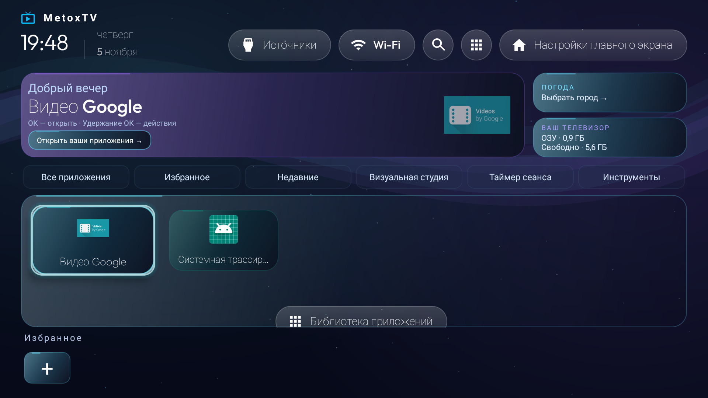

# MetoxTV 4.0.1 — русский интерфейс и упрощённый главный экран

Все экраны лаунчера используют русский язык независимо от языка прошивки: главный экран, визуальная студия, каталог, меню, подсказки, справка, диагностика и заставка. Все 250 переводимых ресурсов имеют русский перевод и русский резервный текст. В APK оставлена русская локализация; системный язык телевизора не изменяется.

Русские названия установленных приложений читаются из их ресурсов. Для стандартных системных утилит предусмотрены русские подписи. Названия брендов, имена пакетов и пользовательские названия сохраняются.

Диалоги используют собственные подписи «Отмена» и «ОК», поэтому не зависят от полноты русских переводов в Android. Время последнего запуска отображается по-русски: «5 минут назад», «сегодня, 19:30», «вчера, 19:30». Часы по умолчанию используют 24-часовой формат. Переведены также диагностический отчёт и сообщения установочного сценария Windows.

Нижняя служебная панель удалена: память и свободное место показаны только в верхнем виджете. Кнопка выбора домашнего приложения убрана с главной страницы, а «Инструменты» перенесены в ряд быстрых действий.

Эффекты, оформление, категории, таймер и все функции 4.0 сохранены. Обновление сохраняет избранное, обои и настройки.

Версия 4.0.1, код версии 18, пакет `com.gathin.tvhome`. Устанавливайте поверх предыдущей нашей версии без удаления приложения. Подпись проверяется при подготовке APK. Итоговые результаты сборки и эмуляторной проверки — в `downloads/VALIDATION.txt`.

Проверка: 369 JVM-тестов и два сценария на эмуляторе Android TV 9 прошли; Android Lint — без ошибок. Размер APK — 456 441 байт. Подпись совпадает с предыдущей опубликованной сборкой. На физическом Sber TV версия 4.0.1 отдельно не проверялась.

[Запись эффектов](../screenshots/ru/home-effects.mp4) · [Каталог на русском](../screenshots/ru/catalog-russian.png) · [Проверка на эмуляторе](https://github.com/aqaq136/TV/actions/runs/42096887260)
